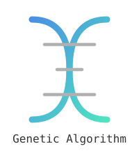

# Genetic Algorithm Example



This project implements a basic genetic algorithm in Python to evolve a population of random strings towards a predefined target phrase. The algorithm simulates natural selection, crossover, and mutation to find the optimal solution.

## Features

-   **Population Generation**: Initializes a diverse population of random individuals (strings).
-   **Fitness Calculation**: Uses the Hamming distance to measure how close an individual string is to the target solution. A lower Hamming distance indicates higher fitness.
-   **Crossover**: Combines genetic material (parts of strings) from two parent individuals to create a new offspring.
-   **Mutation**: Introduces random changes into individuals' strings to maintain diversity and explore new possibilities.
-   **Natural Selection**: Selects the fittest individuals to survive and propagate their genes to the next generation.
-   **Target Solution**: The algorithm aims to evolve strings to match the phrase: "I'm produced by a genetic algorithm!"

## Requirements

-   Python 3.x
-   `textdistance` library

## Installation

1.  Clone the repository:
    ```bash
    git clone https://github.com/your-username/genetic-algorithm-example.git
    cd genetic-algorithm-example
    ```
    (Note: Replace `https://github.com/your-username/genetic-algorithm-Example.git` with the actual repository URL if this project is hosted.)

2.  Install the required Python packages:
    ```bash
    pip install -r requirements.txt
    ```

## Usage

To run the genetic algorithm, execute the `main.py` script:

```bash
python main.py
```

The program will print the best individual found in each generation to the console, showing its evolution towards the target solution.

## Project Structure

-   `main.py`: The entry point of the application, containing the main genetic algorithm loop.
-   `model/`: Contains classes representing the core components of the genetic algorithm:
    -   `Individual.py`: Defines the `Individual` class, representing a single string in the population with its associated fitness.
    -   `Population.py`: Defines the `Population` class, managing a collection of `Individual` objects and handling genetic operations (generation, crossover, natural selection).
-   `utils/`: Contains utility classes and functions:
    -   `Constants.py`: Stores configurable parameters for the algorithm, such as population size, mutation rate, and the target solution.
    -   `TextUtils.py`: Provides static methods for calculating fitness (Hamming distance) and performing mutations on individual strings.

## License

This project is licensed under the Creative Commons Attribution-NonCommercial-NoDerivatives 4.0 International License. See the [LICENSE.md](LICENSE.md) file for details.

[](http://creativecommons.org/licenses/by-nc-nd/4.0/)
